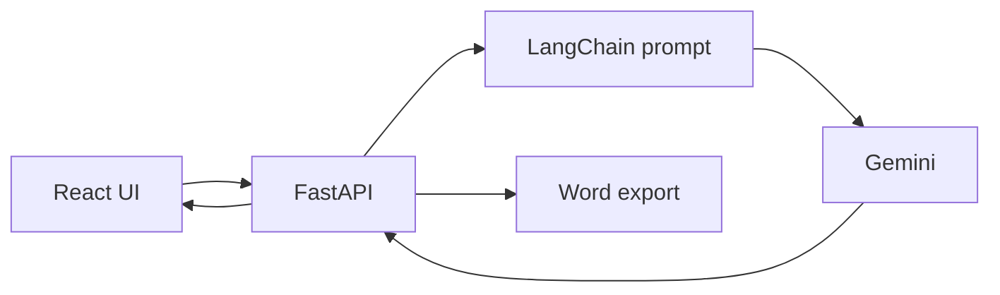

# Pedagogical AI Advisor

> Assistente de IA generativa para planejamento de desenvolvimento profissional docente.

## Visão geral

Aplicação full stack voltada a coordenadores pedagógicos que precisam estruturar planos de ação para professores. A interface conversacional coleta informações sobre o contexto do docente e o backend usa Gemini e LangChain para gerar um plano estruturado, editável e exportável em Word.

## Engenharia

| Camada | Tecnologias |
| --- | --- |
| Frontend | React 19, Vite, Tailwind CSS, Axios |
| Backend | Python, FastAPI, Pydantic |
| IA generativa | Gemini 2.5 Flash, LangChain |
| Exportação | python-docx |



## Funcionalidades

- Interface conversacional para elaboração de planos de desenvolvimento docente.
- Estado estruturado do documento com identificação, competência-alvo e plano de ação.
- Geração de sugestões de pesquisa, ações práticas, indicadores de sucesso e estudo semanal.
- Suporte a imagem opcional enviada ao modelo.
- Exportação do plano em formato DOCX.

## Executar localmente

Pré-requisitos: Python 3.10+, Node.js compatível com Vite 7 e uma chave de API do Google Gemini.

Backend:

```bash
cd backend
python -m venv .venv
# Ative o ambiente virtual conforme seu sistema operacional
pip install -r requirements.txt
```

Crie um arquivo local `backend/.env` contendo `GOOGLE_API_KEY` (não publique a chave). Em seguida:

```bash
python main.py
```

Frontend, em outro terminal:

```bash
cd frontend
npm ci
npm run dev
```

Confira a configuração da URL do backend no frontend antes de executar.

## API

| Método | Rota | Descrição |
| --- | --- | --- |
| POST | /api/chat | Gera a resposta do assistente e atualiza o plano |
| POST | /api/download | Exporta o plano em Word |

## Limitações e próximos passos

O sistema gera sugestões com IA, que devem ser revisadas por um profissional da educação. A implementação atual não comprova a existência de referências bibliográficas geradas pelo modelo. Antes de um uso em produção, revisar autenticação, política CORS, privacidade, tratamento de erros, validação de saída e testes automatizados. Não enviar dados pessoais de professores sem autorização.

*Documentation reflects the current repository implementation; production deployment and test coverage have not been independently verified.*
